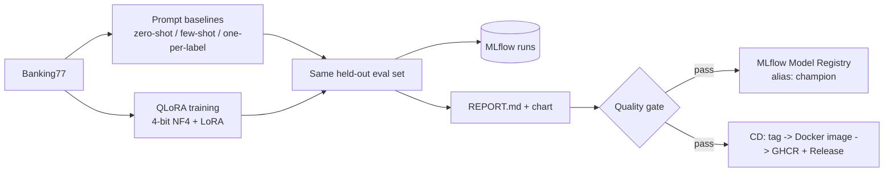

# project3-finetune: QLoRA fine-tune vs prompt-engineering baseline

**Question:** for a narrow, high-volume task, is it worth fine-tuning a small open LLM with QLoRA, or can careful prompting get you there?

**Task:** Banking77 intent classification (77 customer-support intents), a good stress test because a prompt has to describe 77 labels while a fine-tuned model can simply learn them.

**Stack:** Hugging Face Transformers + PEFT + bitsandbytes (QLoRA), MLflow (tracking + model registry), pytest/ruff, GitHub Actions (CI + CD), FastAPI + Docker (serving).



## Experimental design (what makes the comparison fair)

| Choice | Why |
|---|---|
| Same 4-bit base model for baselines and fine-tune | Isolates the effect of the adapter, not quantization |
| Baselines include a strong **one-example-per-label** prompt | A weak baseline would make the fine-tune win trivially |
| Disjoint splits: val carved from train; all metrics on test | No leakage; few-shot examples come from train only |
| Loss on label tokens only (prompt masked) | Standard supervised fine-tuning for classification-by-generation |
| Invalid generations count as errors | Prompting often yields off-list answers; hiding that would flatter baselines |
| Accuracy with bootstrap 95% CI, macro-F1, invalid rate, prompt tokens, latency | Quality **and** cost |
| Fixed seed, greedy decoding | Reproducible |

## Quickstart

Needs an NVIDIA GPU for training/eval (free Colab T4 works). No GPU is needed for tests, lint, report, or gate.

```bash
pip install -e ".[train,dev,serve]"
make smoke        # ~minutes, tiny model: verify the pipeline end to end
make all          # baselines -> train -> eval -> report -> gate
make promote      # register adapter in the MLflow Model Registry if gate passes
make ui           # browse runs at http://127.0.0.1:5000
```

Colab: open `notebooks/colab_run.ipynb`.

Override anything without editing YAML: `python -m p3ft.train --set train.epochs=3 qlora.r=32`.

## Results

> Fill in after your run: copy from `results/REPORT.md`.

| Run | Accuracy | Macro-F1 | Prompt tokens | ms/sample |
|---|---|---|---|---|
| baseline-zero_shot | | | | |
| baseline-few_shot | | | | |
| baseline-one_per_label | | | | |
| **finetuned-qlora** | | | | |


## MLOps and CI/CD

- **Tracking:** every train/eval run logs params, metrics, predictions CSV and result JSON to MLflow (`sqlite:///mlflow.db`).
- **Registry:** `make promote` registers the adapter as `banking77-qlora-adapter` with the `champion` alias and metric tags, only if the gate passes.
- **CI (`ci.yml`):** ruff + pytest on Python 3.10/3.12 (CPU only, no model downloads), then the quality gate on committed `results/*.json`.
- **CD (`cd.yml`):** pushing a `v*` tag re-runs tests and the gate, builds the serving image, pushes to GHCR, and publishes a GitHub Release with `REPORT.md`.
- **Gate rule (`configs/default.yaml`):** fine-tune must beat the *best* prompt baseline by >= 0.05 macro-F1, with accuracy >= 0.80 and invalid rate <= 2%.
- GitHub-hosted runners have no GPU, so training runs on Colab/Kaggle/your GPU box (or a self-hosted runner via `train.yml`); CI gates the **results it produces**.

## Serving

```bash
ADAPTER_PATH=outputs/qlora-banking77 uvicorn p3ft.serve:create_default_app --factory --port 8000
curl -s localhost:8000/classify -H 'content-type: application/json' \
     -d '{"text":"My card has not arrived yet"}'
```

## Layout

```
configs/        default.yaml (full run), smoke.yaml (quick check)
src/p3ft/       data, prompts, metrics, tokenization, modeling, train, evaluate, report, quality_gate, serve
tests/          36 tests: data splits, prompts, label normalisation, loss masking, eval loop, gate, MLflow registry, API
results/        committed result JSON + REPORT.md + comparison.png
.github/        ci.yml, cd.yml, train.yml (optional self-hosted GPU)
```

## Limitations / next steps

- Single seed and a 1,000-example eval subset; use `--set data.eval_size=null` for the full 3,080 test set and repeat across seeds for tighter intervals.
- Latency is amortised per sample at the configured batch size on one GPU; it is a relative, not absolute, number.
- Natural extensions: a larger base model, LoRA rank sweep (MLflow makes this easy), retrieval-augmented few-shot as a stronger baseline, merging the adapter for faster serving.
