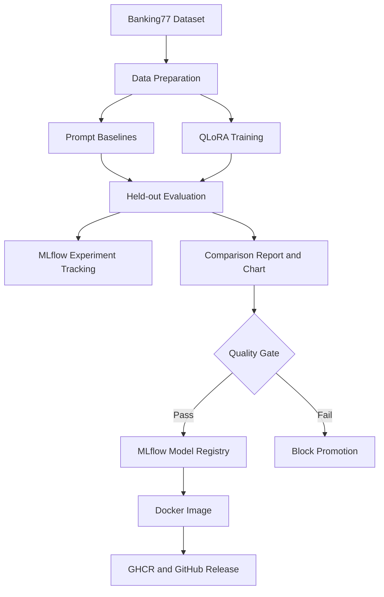

# JANUS: QLoRA Fine-Tuning vs Prompt Engineering

[](https://github.com/IamKD64/janus-llm/actions/workflows/ci.yml)

An end-to-end, reproducible comparison of **QLoRA fine-tuning** against **prompt engineering** for a narrow, high-volume LLM task. JANUS combines model evaluation, experiment tracking with MLflow, automated quality gates, model registration, and CI/CD.

**Task:** Banking77 intent classification — map a customer-support message to one of 77 banking intents.  
**Model:** `Qwen/Qwen2.5-1.5B-Instruct`, loaded in 4-bit.  
**Research question:** Is fine-tuning a small open model worth it, or can careful prompting achieve comparable results?

## Results

All approaches were evaluated on the same **1,000 held-out Banking77 test examples**, using seed 42 and greedy decoding.

| Run | Accuracy (95% CI) | Macro-F1 | Invalid % | Prompt tokens | ms / sample |
|---|---:|---:|---:|---:|---:|
| Zero-shot prompt | 0.407 (0.375–0.439) | 0.382 | 2.9 | 514 | 732 |
| Few-shot prompt (5 examples) | 0.424 (0.391–0.454) | 0.404 | 3.5 | 637 | 905 |
| One-example-per-label prompt | 0.451 (0.420–0.478) | 0.427 | 3.4 | 1,959 | 2,594 |
| **QLoRA fine-tune** | **0.870 (0.850–0.890)** | **0.870** | **0.0** | **515** | **813** |

### Model comparison


### Key findings

- **Fine-tuning roughly doubled accuracy:** 87.0% compared with 45.1% for the strongest prompt baseline.
- **Invalid outputs dropped to zero:** prompt baselines produced approximately 3% invalid outputs, while the fine-tuned model produced none.
- **The quality gate passed:** macro-F1 improved by **+0.443** over the best prompt baseline, exceeding the required +0.05 improvement.
- **The gain was not due to a longer prompt:** the fine-tuned run used approximately 515 prompt tokens, comparable to zero-shot prompting at 514 tokens.
- **Lower cost than the strongest prompt baseline:** the fine-tuned run used 3.8× fewer prompt tokens and approximately 3× less time per sample than the one-example-per-label baseline. Against zero-shot prompting, there was no meaningful prompt-token saving.
- **Remaining errors involve similar intents**, including `card_delivery_estimate` vs `card_arrival` and `card_acceptance` vs `supported_cards_and_currencies`.

The full experiment is documented in the notebooks, and the generated evaluation report is available at [`results/REPORT.md`](results/REPORT.md).

> **Important:** These metrics describe the evaluated experiment using the prompt configuration at that time. The fine-tuning prompt has since been shortened in the current source code. The reported results have not yet been re-established using that newer prompt.

## Experimental methodology

The comparison was designed to make the prompt baselines and fine-tuned model as comparable as possible.

| Design choice | Why it matters |
|---|---|
| Same 4-bit base model for baselines and fine-tuning | Isolates the effect of adapter training rather than quantization |
| Strong prompt baselines, including one example for every label | Avoids making fine-tuning appear better by comparing it against weak prompts |
| Validation split carved out of training data | Keeps validation separate from the held-out evaluation set |
| Few-shot examples selected from training data only | Prevents evaluation-data leakage |
| Loss computed on label tokens only, with prompt tokens masked | Focuses supervised training on generating the target intent |
| Invalid generations counted as errors | Prevents off-list outputs from artificially improving baseline scores |
| Accuracy with bootstrap 95% CI, macro-F1, invalid rate, prompt tokens, and latency | Evaluates both prediction quality and inference cost |
| Fixed seed, greedy decoding, and identical evaluation examples | Supports reproducibility; identical baseline metrics were observed in two separate runs |

## Pipeline architecture



## Quickstart

### 1. Clone the repository

```bash
git clone https://github.com/IamKD64/janus-llm.git
cd janus-llm
```

### 2. Run without a GPU

Testing, linting, report generation, and quality-gate checks do not require an NVIDIA GPU.

```bash
pip install -e ".[dev]"

make test
make lint
```

### 3. Run with an NVIDIA GPU

Training and model evaluation require an NVIDIA GPU. The full experiment was run on Kaggle Tesla T4 hardware.

Install the training and serving dependencies:

```bash
pip install -e ".[train,dev,serve]"
```

Run the pipeline stages:

```bash
make smoke        # Tiny end-to-end pipeline check
make baseline     # Evaluate prompt-engineering baselines
make train        # QLoRA fine-tuning
make eval-ft      # Evaluate the fine-tuned adapter
make report       # Generate REPORT.md and comparison.png
make gate         # Run the release quality gate
make promote      # Register the adapter if the gate passes
make ui           # Open the MLflow UI at localhost:5000
```

Run the smoke test first to verify the environment before committing GPU time to the full experiment.

### Configuration overrides

Experiment settings can be overridden from the command line without editing YAML files.

```bash
python -m p3ft.train 
  --config configs/default.yaml 
  --set train.epochs=3 qlora.r=32
```

### Notes for a 15 GB NVIDIA T4 (Kaggle / Colab)

The default micro-batch size of 8 exceeded the available GPU memory or caused training failures on the tested T4 setup.

The reported experiment used a micro-batch size of 1 with gradient accumulation of 16, giving an effective batch size of 16:

```bash
python -m p3ft.train 
  --config configs/default.yaml 
  --set train.batch_size=1 train.grad_accum=16
```

Additional notes:

- On a machine with multiple GPUs, restrict execution to one GPU with `CUDA_VISIBLE_DEVICES=0` if needed.
- Observed Kaggle execution times were approximately 70 minutes for prompt baselines, 4 hours 45 minutes for training, and 14 minutes for fine-tuned evaluation.
- Free-tier notebook session limits can interrupt long runs. Execute stages separately and preserve generated artifacts between sessions.
- Avoid running `make all` again if baseline results already exist, as it repeats the baseline evaluation.

## Experiment configuration

The full experiment is defined in [`configs/default.yaml`](configs/default.yaml). A smaller configuration for quick pipeline checks is available in [`configs/smoke.yaml`](configs/smoke.yaml).

| Setting | Value |
|---|---|
| Dataset | `PolyAI/banking77` |
| Fine-tuning data | 3,000 training examples |
| Validation data | 200 examples |
| Evaluation data | 1,000 held-out test examples |
| Base model | `Qwen/Qwen2.5-1.5B-Instruct` |
| Quantization | 4-bit NF4 with double quantization |
| LoRA rank | 16 |
| LoRA alpha | 32 |
| LoRA dropout | 0.05 |
| Target modules | All linear layers |
| Trainable parameters | 18,464,768 (2.04%) |
| Training epochs | 2 |
| Learning rate | 2e-4 |
| Learning-rate schedule | Cosine |
| Effective batch size | 16 |
| Final validation loss | 0.104 |
| Random seed | 42 |

## MLOps and CI/CD

JANUS includes an experiment-management and release workflow designed to prevent underperforming models from being promoted.

### Experiment tracking — MLflow

Training and evaluation runs log:

- Experiment parameters and hyperparameters
- Accuracy, macro-F1, and invalid-output metrics
- Per-example predictions
- Result JSON artifacts
- Model and training metadata

The configured tracking backend uses SQLite.

### Model registry

The `make promote` command registers the trained adapter in the MLflow Model Registry as:

- **Registered model:** `banking77-qlora-adapter`
- **Version:** 1 for the reported run
- **Alias:** `champion`

Promotion occurs only after the quality gate passes. Evaluation metrics are also recorded as model-version tags.

### Automated quality gate

The fine-tuned model must satisfy all three release conditions:

| Metric | Requirement |
|---|---|
| Macro-F1 improvement over the best prompt baseline | At least +0.05 |
| Accuracy | At least 0.80 |
| Invalid-output rate | At most 2% |

The reported QLoRA run passed all three conditions:

| Check | Requirement | Observed | Status |
|---|---:|---:|---|
| Macro-F1 improvement | ≥ +0.05 | +0.443 | PASS |
| Accuracy | ≥ 0.80 | 0.870 | PASS |
| Invalid-output rate | ≤ 2% | 0.0% | PASS |

The quality-gate command exits with a non-zero status when a condition fails, preventing model promotion.

### GitHub Actions

| Workflow | Responsibility |
|---|---|
| `ci.yml` | Ruff linting/format checks, pytest on Python 3.10 and 3.12, and quality-gate validation |
| `cd.yml` | Re-runs tests and the gate on version tags, builds the serving image, pushes it to GHCR, and publishes a GitHub Release |
| `train.yml` | Optional full pipeline execution on a self-hosted GPU runner |

GitHub-hosted runners do not provide the GPU environment required for this training workload. Training therefore runs on Kaggle, Colab, a local GPU, or an appropriately configured self-hosted runner. CI validates the committed results rather than retraining the model on every push.

## Model serving (experimental)

JANUS includes a FastAPI service that loads the 4-bit base model together with the trained adapter and exposes two endpoints:

- `/classify` — classify a customer-support message.
- `/health` — service health check.

The API layer is covered by unit tests using a stub classifier. End-to-end serving with the real adapter on GPU hardware has not yet been benchmarked.

Start the service:

```bash
ADAPTER_PATH=outputs/qlora-banking77 
uvicorn p3ft.serve:create_default_app --factory --port 8000
```

Example request:

```bash
curl -s http://localhost:8000/classify 
  -H 'content-type: application/json' 
  -d '{"text":"My card has not arrived yet"}'
```

**Adapter hosting:** The trained adapter is approximately 70 MB and is intentionally not stored in Git. Mount it into the serving environment or publish it to the Hugging Face Hub.

## Experiment notebooks and reports

The repository includes the experiment notebooks and generated evaluation artifacts.

| Resource | Description |
|---|---|
| [`notebooks/janus-llm.ipynb`](notebooks/janus-llm.ipynb) | Executed Kaggle experiment notebook |
| [`notebooks/janus-llm_documented.ipynb`](notebooks/janus-llm_documented.ipynb) | Documented notebook with explanations of the experiment stages |
| [`results/REPORT.md`](results/REPORT.md) | Detailed evaluation report |
| [`results/comparison.png`](results/comparison.png) | Model comparison chart |

## Project structure

```text
janus-llm/
│
├── .github/
│   └── workflows/       # CI, CD, and optional GPU-training workflows
│
├── configs/
│   ├── default.yaml     # Full experiment configuration
│   └── smoke.yaml       # Lightweight pipeline configuration
│
├── data/                # Dataset handling and related assets
│
├── notebooks/
│   ├── janus-llm.ipynb
│   └── janus-llm_documented.ipynb
│
├── results/
│   ├── REPORT.md
│   ├── comparison.png
│   └── Result JSON files
│
├── src/
│   └── p3ft/
│       ├── data
│       ├── prompts
│       ├── metrics
│       ├── tokenization
│       ├── modeling
│       ├── train
│       ├── evaluate
│       ├── report
│       ├── quality_gate
│       └── serve
│
├── tests/               # Unit and integration tests
│
├── Dockerfile           # Inference container
├── Makefile             # Pipeline commands
├── pyproject.toml       # Project dependencies and tooling
└── README.md
```

## Limitations and next steps

### Current limitations

- **Single run and single seed:** The reported experiment uses seed 42 and 1,000 evaluation examples. The bootstrap 95% confidence interval is approximately ±2 percentage points, but repeating the experiment across multiple seeds would provide a more robust estimate.
- **Training data is a subset:** Only 3,000 of approximately 9,800 available training examples were used. Training with more data or additional epochs may improve performance.
- **Long fine-tuning prompt:** The reported run used approximately 515 prompt tokens, contributing to a training time of about 38 seconds per optimizer step. The shortened prompt in the current source code has not yet been evaluated in a new full experiment.
- **Relative latency measurements:** Latency was measured per sample at batch size 8 on the tested GPU setup. These values are useful for comparing the approaches under that setup, not as universal production latency estimates.
- **Serving validation:** The API is covered by stub-based tests, but real-adapter GPU inference has not yet been benchmarked end to end.

### Future improvements

1. Retrain and evaluate with the shortened fine-tuning prompt.
2. Repeat experiments across multiple random seeds and report mean and standard deviation.
3. Perform LoRA rank and learning-rate sweeps using MLflow.
4. Evaluate retrieval-augmented few-shot prompting as a stronger baseline.
5. Publish the adapter to the Hugging Face Hub.
6. Benchmark merged-adapter inference and production serving performance.

## Tech stack

| Category | Technologies |
|---|---|
| Language | Python |
| Base model | Qwen2.5-1.5B-Instruct |
| Fine-tuning | Hugging Face Transformers, PEFT, bitsandbytes, QLoRA |
| Dataset and metrics | Hugging Face Datasets, scikit-learn |
| Experiment tracking | MLflow |
| API serving | FastAPI, Uvicorn |
| Containerization | Docker |
| CI/CD | GitHub Actions, GitHub Container Registry |
| Testing and code quality | pytest, Ruff |
| Compute | Kaggle NVIDIA Tesla T4 |

---

**JANUS** — exploring the trade-offs between prompt engineering and parameter-efficient fine-tuning through reproducible experimentation and practical MLOps.